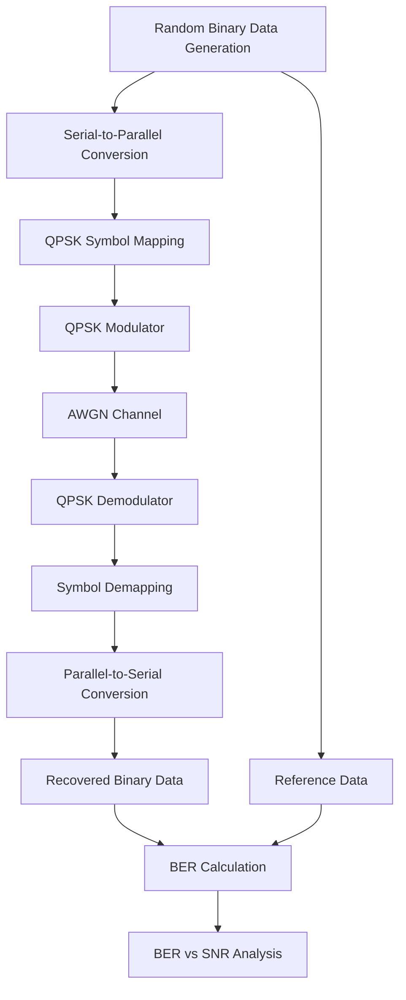

# QPSK Baseband Transceiver

**AWGN Channel Modelling and Bit Error Rate (BER) Performance Analysis**

MATLAB implementation of a QPSK baseband transceiver with AWGN channel simulation and BER evaluation against theory.

---

## Table of Contents

1. [Overview](#overview)
2. [Objectives](#objectives)
3. [System Architecture](#system-architecture)
4. [Theoretical Background](#theoretical-background)
5. [Simulation Methodology](#simulation-methodology)
6. [Results and Analysis](#results-and-analysis)
7. [Tools](#tools)
8. [Repository Structure](#repository-structure)
9. [Applications](#applications)
10. [Future Scope](#future-scope)

---

## Overview

This project presents the design and simulation of a Quadrature Phase Shift Keying (QPSK) baseband transceiver operating over an Additive White Gaussian Noise (AWGN) channel.

The system implements QPSK modulation and demodulation, channel noise modelling, and Bit Error Rate (BER) evaluation. The focus is to investigate how channel noise affects the reliability of digital data transmission and to analyse the relationship between signal-to-noise ratio and BER.

## Objectives

- Design and implement a QPSK-based digital communication system.
- Develop a baseband transmitter and receiver architecture.
- Model an AWGN communication channel.
- Evaluate system performance under varying noise conditions.
- Calculate and analyse the Bit Error Rate.
- Compare simulated BER with theoretical results.

---

## System Architecture



| Functional Block | Description |
|---|---|
| Bit Generation | Generates a random binary information sequence |
| Serial-to-Parallel | Groups incoming bits into pairs |
| QPSK Modulator | Maps bit pairs to four distinct phase states |
| AWGN Channel | Adds Gaussian noise to the transmitted signal |
| QPSK Demodulator | Recovers transmitted symbols from the received signal |
| Symbol Demapping | Converts detected symbols back into binary data |
| BER Calculation | Counts incorrectly received bits |
| Performance Analysis | Evaluates BER across SNR values |

---

## Theoretical Background

### Quadrature Phase Shift Keying

QPSK represents binary information using four distinct carrier phase states. Each symbol carries two bits, giving higher spectral efficiency than BPSK.

### Additive White Gaussian Noise

The received signal is modelled as:

<p align="center"><i>r</i>(<i>t</i>) = <i>s</i>(<i>t</i>) + <i>n</i>(<i>t</i>)</p>

where <i>r</i>(<i>t</i>) is the received signal, <i>s</i>(<i>t</i>) is the transmitted signal, and <i>n</i>(<i>t</i>) is additive white Gaussian noise.

### Signal-to-Noise Ratio

<p align="center">SNR = <i>P</i><sub>s</sub> / <i>P</i><sub>n</sub></p>

where <i>P</i><sub>s</sub> is the signal power and <i>P</i><sub>n</sub> is the noise power.

### Bit Error Rate

<p align="center">BER = <i>N</i><sub>error</sub> / <i>N</i><sub>total</sub></p>

where <i>N</i><sub>error</sub> is the number of incorrectly received bits and <i>N</i><sub>total</sub> is the total number of transmitted bits.

### Theoretical QPSK Performance

For coherent QPSK with Gray coding over an AWGN channel:

<p align="center">BER = <i>Q</i>( &radic;( 2<i>E</i><sub>b</sub> / <i>N</i><sub>0</sub> ) )</p>

where <i>E</i><sub>b</sub> is the energy per bit, <i>N</i><sub>0</sub> is the noise power spectral density, and <i>Q</i>(<i>x</i>) is the Gaussian Q-function. This expression serves as the reference for validating the simulation.

---

## Simulation Methodology

| Stage | Description |
|---|---|
| 1. Data Generation | Generate a random binary information sequence |
| 2. Modulation | Convert binary data into QPSK symbols using phase mapping |
| 3. Channel Modelling | Transmit symbols through an AWGN channel at different SNR values |
| 4. Demodulation | Recover information from the noisy received signal |
| 5. BER Computation | Compare transmitted and recovered sequences to count bit errors |
| 6. Performance Evaluation | Analyse BER versus SNR and compare with theory |

---

## Results and Analysis

As SNR increases, the influence of noise decreases and the probability of bit errors falls. The simulated BER curve is compared against the theoretical QPSK curve to assess the accuracy of the implemented model.

<p align="center">
  
</p>

---

## Tools

| Tool | Application |
|---|---|
| MATLAB | System modelling and simulation |

---

## Repository Structure

```text
QPSK-Baseband-Transceiver-AWGN-BER-Analysis/
├── README.md
├── MATLAB/
│   └── QPSK_Transceiver.m
├── Results/
│   └── BER_vs_SNR.png
└── Documentation/
    └── Project_Report.pdf
```

---

## Applications

- Satellite communication systems
- Aerospace and aviation communication
- Digital radio communication
- Wireless communication networks
- Space communication systems
- Digital broadcasting

---

## Future Scope

- Performance comparison of BPSK, QPSK, 8-PSK and QAM
- Rayleigh and Rician fading channels
- Constellation diagram analysis
- Channel coding techniques
- Higher-order modulation schemes
- Simulation of practical communication impairments
